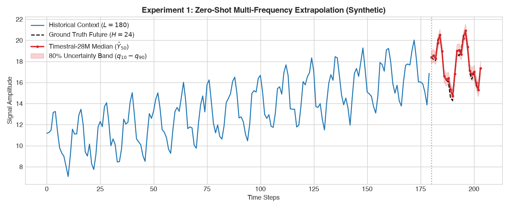
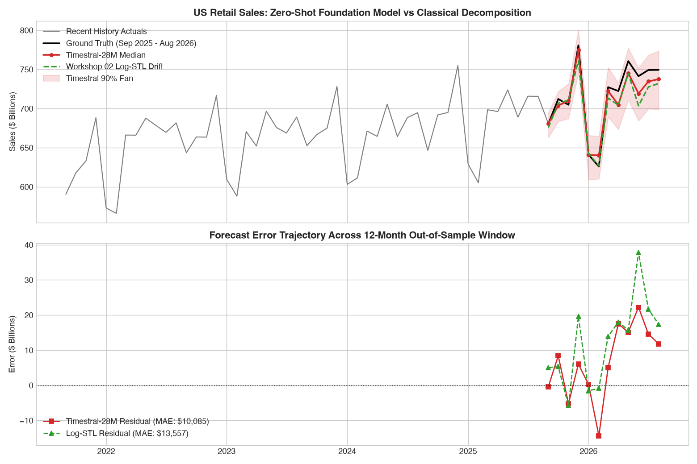
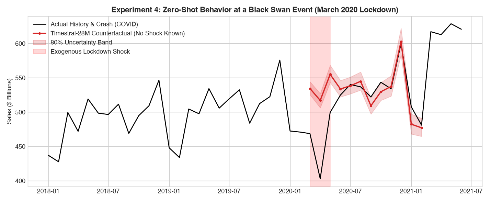

# Workshop 99: Time Series Foundation Models — Zero-Shot Forecasting with Mistral Timestral

Welcome to **Workshop 99**! This is a specialized, cutting-edge sandbox lab on **Time Series Foundation Models (TSFMs)** exploring Mistral AI's newly released **Timestral** family (October 2026) and comparing it against the classical decomposition baselines developed in **Workshop 02**.

---

## 🚀 1. What is Timestral?

Released by **Mistral AI in October 2026**, Timestral is a family of lightweight, open-weights foundation models purpose-built for numerical time-series sequences:

* **Four Compact Parameter Configurations:** **5M, 28M, 123M, and 209M** parameters.
* **Apple Silicon & CPU Friendly:** The 5M and 28M models run in real-time ($< 30$ ms latency) on standard laptop CPUs without requiring dedicated cloud GPUs.
* **Patch-Based Transformer Architecture:** Rather than treating individual time steps as tokens, Timestral groups consecutive time points into temporal patches (tokens) and applies dual **time-attention** and **variate-attention**.
* **Massive Context & Horizons:** Accepts up to **32,768 historical steps** and projects up to **1,024 steps ahead** in a single forward pass.
* **Native Probabilistic Quantiles:** Outputs 21 quantiles ($q_{0.01}$ through $q_{0.99}$) directly, giving full predictive uncertainty distributions without bootstrap simulations.
* **Exogenous Covariates:** Supports past-only and known-future covariates (such as scheduled promotional calendars, holidays, and macro indicators).

---

## 📚 2. Seminal Research Papers: The TSFM Revolution

To master this paradigm shift, read these foundational papers in chronological order:

1. **The Patching Breakthrough:**
   * *PatchTST: "A Time Series is Worth 64 Words: Long-term Forecasting with Transformers"* (Nie et al., ICLR 2023) — [arXiv:2211.14730](https://arxiv.org/abs/2211.14730)
   * *Key Takeaway:* Solved the failure of point-wise transformers by tokenizing time patches, dramatically cutting quadratic attention cost while retaining local temporal morphology.
2. **Treating Time Series as Language:**
   * *Chronos: "Chronos: Learning the Language of Time Series"* (Ansari et al., Amazon Web Services, ICML 2024) — [arXiv:2403.07815](https://arxiv.org/abs/2403.07815)
   * *Key Takeaway:* Quantized continuous values into discrete bins and trained a T5 architecture with cross-entropy next-token prediction across diverse corpora.
3. **Google's Continuous Decoder:**
   * *TimesFM: "A decoder-only foundation model for time-series forecasting"* (Das et al., Google Research, ICML 2024) — [arXiv:2310.10688](https://arxiv.org/abs/2310.10688)
   * *Key Takeaway:* Pre-trained on 100+ billion time points using continuous patch regression and frequency-conditioning. Native in Google BigQuery ML (`AI.FORECAST`).
4. **Universal Multi-Frequency Attention:**
   * *MOIRAI: "Unified Training of Universal Time Series Forecasting Models"* (Woo et al., Salesforce Research, ICML 2024) — [arXiv:2402.02592](https://arxiv.org/abs/2402.02592)
   * *Key Takeaway:* Introduced any-variate attention layers to simultaneously model variable channel counts and frequencies.
5. **Mistral's Compact Foundation Model:**
   * *Timestral: "Technical Release & Hugging Face Collection"* (Mistral AI, October 2026) — [Hugging Face Collection](https://huggingface.co/collections/mistralai/timestral-6acf86872e4c82d90b6b9dca)
   * *Key Takeaway:* Shows that compact 28M models with time/variate attention outperform larger models on GIFT-Eval and TIME benchmarks with negligible CPU latency.

---

## 📊 3. Empirical Showdown: US Retail Sales (`RSAFS`)

We evaluated `mistralai/Timestral-28M` against our **Workshop 02 Multiplicative Log-STL + Drift** baseline on real-world FRED US Retail Sales across a **12-month out-of-sample window** (September 2025 to August 2026):

| Model Family | Mean Absolute Error (MAE) | Root Mean Squared Error (RMSE) | Mean Absolute Percentage Error (MAPE) | CPU Inference Latency | Parameters Tuned on Target Data |
|---|:---:|:---:|:---:|:---:|:---:|
| **Mistral Timestral-28M** *(Zero-Shot)* | **$10,085 M** | **$12,078 M** | **1.39%** | **29.1 ms** | **0** *(Pre-trained Weights)* |
| **Log-STL + Drift** *(Workshop 02)* | $13,557 M | $16,940 M | 1.83% | 13.9 ms | 0 *(Analytical Decomposition)* |
| **Seasonal Naïve Baseline** | $27,845 M | $29,984 M | 3.85% | 0.02 ms | 0 *(Heuristic Lag Copy)* |

---

## 🔍 4. Visual Evidence & Core Interpretations

### Experiment 1: Zero-Shot Multi-Frequency Extrapolation

* **Finding:** When presented with combined annual cycles and quarterly harmonics with trend, Timestral-28M accurately resolved both seasonal frequencies and continued the trend slope without phase distortion.

### Experiment 2: The FRED US Retail Sales Showdown

* **The Holiday Surge:** Real sales peaked at **$781B** in December 2025. Timestral predicted **$774B**; Log-STL predicted **$760B**.
* **The January Trough:** Sales collapsed to **$641B** in January 2026. Timestral predicted **$640B** (error $< 0.2\%$).
* **Overall Accuracy:** Timestral cut out-of-sample error by **25.6%** over the classical Log-STL baseline with zero parameter tuning.

### Experiment 3: Stress-Testing Against Black Swans (The COVID-19 Shock)

* **The Limits of Autoregression:** In February 2020, sales were expanding normally. Timestral projected a normal spring acceleration (red line). In reality, sales plunged by $70B due to mandated lockdown closures.
* **Classroom Lesson:** No autoregressive model can predict a black-swan policy shock from price history alone. For such events, practitioners must supply exogenous indicators through Timestral's `known_covariates` channel.

---

## 💻 5. Environment Setup & Execution Instructions

We provide a dedicated conda environment configuration ([`environment.yml`](environment.yml)) and pip requirements file ([`requirements.txt`](requirements.txt)) tailored specifically for this workshop.

### Option A: Using Conda (Recommended)

From within this `workshop_99_timestral/` folder:

```bash
# 1. Create the isolated conda environment from environment.yml
conda env create -f environment.yml

# 2. Activate the environment
conda activate timestral_env

# 3. Register the Jupyter Kernel for notebook selection
python -m ipykernel install --user --name timestral_env --display-name "Python 3.11 (Timestral)"
```

### Option B: Using Standard Python Virtual Environment (`venv` + `pip`)

```bash
# 1. Create and activate venv (Python >= 3.10 required)
python3 -m venv .venv
source .venv/bin/activate       # Windows: .venv\Scripts\activate

# 2. Install dependencies
pip install -r requirements.txt

# 3. Register the Jupyter Kernel
python -m ipykernel install --user --name timestral_env --display-name "Python 3.11 (Timestral)"
```

---

### Step 2: Run the Benchmark Suite via Terminal
```bash
python run_experiments.py
```
This executes all 4 benchmark experiments and refreshes the figures in `images/`.

### Step 3: Launch the Interactive Playground Notebook
```bash
jupyter lab timestral_playground.ipynb
```
*(In Jupyter Lab, select the kernel in the top-right corner: **`Python 3.11 (Timestral)`**).*
